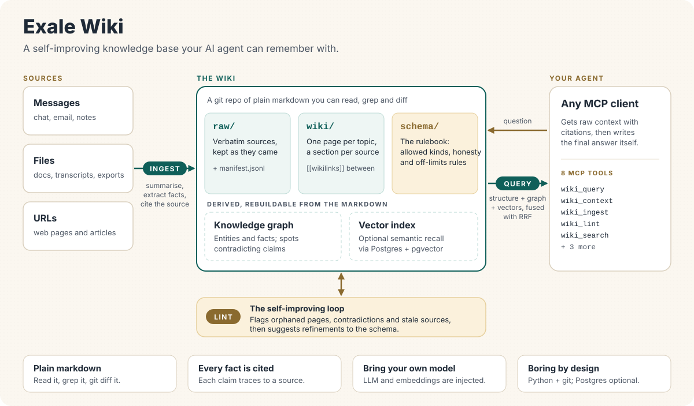

# Exale Wiki

<p align="center">
  
</p>

**A long-term memory your AI agent can read, write and keep tidy — stored as plain
markdown in a git repo.**

[](https://github.com/Exale-AB/exale-wiki/actions/workflows/ci.yml)


[](LICENSE)

**611 tests · 91.1% coverage · ruff + pyright clean**

## What is this?

AI agents forget. Every conversation starts from zero, and the things worth
remembering — a customer's renewal date, how a process works, who owns what — end up
scattered across chats and documents.

Exale Wiki gives an agent somewhere durable to put that knowledge:

- **Feed it sources** (messages, files, URLs). It writes a summary page, pulls out the
  people, organisations and facts, and records which source each one came from.
- **Ask it questions.** It returns the relevant pages as raw context with citations, and
  your agent writes the answer. The wiki never invents a reply of its own.
- **Let it check itself.** Lint finds orphaned pages, contradicting facts and stale
  sources, and suggests how to tighten the rulebook.

Everything lives in ordinary files you can open, `grep` and `git diff`. There is no
proprietary store to export from.

**Good fit if** you are building an agent that needs grounded, citable memory about a
person, team or customer — and you want to audit exactly what it knows.

**Not a fit if** you want a hosted product, a chat UI, or a vector database. This is an
engine; you bring the agent and the model.

## How it works

| Operation | What happens | Where it lives |
|-----------|--------------|----------------|
| **Ingest** | A source is summarised into a page, entities and facts are extracted, and the index and log are updated. Re-ingesting the same content is a no-op. | `ingest.py` |
| **Query** | Three signals are fused — keyword/structure, knowledge-graph walk, vector similarity — and the best pages come back with citations. | `retrieval.py`, `query.py` |
| **Lint** | Pluggable rules flag orphans, contradictions and stale sources, then aggregate them into suggested schema refinements. | `lint.py` |

A wiki is a git repo with three folders:

```
my-wiki/
├── raw/      verbatim sources, kept exactly as they arrived
├── wiki/     one markdown page per topic (plus index.md and log.md)
└── schema/   AGENTS.md — the rulebook: allowed source kinds, honesty rules, off-limits topics
```

Every operation ends in a git commit, so the history of what the wiki learned, and
when, is just `git log`.

## Try it in two minutes

No API key, no database. The summariser, embedder and answerer are the deterministic
fakes the engine uses in its own tests.

```bash
git clone https://github.com/Exale-AB/exale-wiki.git
cd exale-wiki
uv sync                      # needs uv: https://docs.astral.sh/uv/

git init /tmp/my-wiki
uv run python examples/quickstart.py /tmp/my-wiki
```

You should see the retrieved context, its citation, and an empty lint report:

```
Question: When is the Acme renewal?

## <today> — slack:42

Summary of Acme renewal: Acme renewal is due 1 March. Contact: Dana Berg.

cited: ('acme-renewal',)
lint: []
```

Then look at what it wrote:

```bash
git -C /tmp/my-wiki log --oneline       # the ingest is a commit
cat /tmp/my-wiki/wiki/acme-renewal.md   # the page, with its source recorded
```

[`examples/quickstart.py`](examples/quickstart.py) is about 50 lines — read it to see the
whole API surface in one place. It is run by the test suite, so it will not go stale.

## Use it with a real model and agent

The engine ships an MCP server that exposes the wiki to any agent as tools. It speaks
JSON-RPC over stdin/stdout and is exercised against [Hermes Agent](https://hermes-agent.nousresearch.com/docs/) from Nous Research.

Create a wiki once. The server serves an existing wiki and does not create one, so a
missing `raw/`, `wiki/` and `schema/` shows up as a file-not-found error on first use:

```bash
git init ~/my-wiki
uv run python -c "from pathlib import Path; from wiki_engine import WikiRepo; WikiRepo.init(Path.home() / 'my-wiki')"
```

Run that from your clone of this repo (after `uv sync`). The server then starts with:

```bash
WIKI_REPO_PATH=~/my-wiki uv run --directory /path/to/exale-wiki python -m wiki_engine
```

It also installs with `pip install "wiki-engine[llm,extraction] @ git+https://github.com/Exale-AB/exale-wiki#subdirectory=packages/wiki-engine"`,
after which `python -m wiki_engine` is the command; use that interpreter's absolute path
in the configs below.

### Connect it to your agent

The server is plain MCP over stdio, so any MCP client can use it. Every client needs the
same three things: a **name** (`wiki-engine`), a **command** that starts the server, and
the **`WIKI_REPO_PATH`** of your wiki. Use absolute paths — clients launch the command
without your shell's `PATH` or working directory.

**Claude Code**

```bash
claude mcp add wiki-engine --scope user --env WIKI_REPO_PATH=$HOME/my-wiki -- \
  uv run --directory /path/to/exale-wiki python -m wiki_engine
```

**Claude Desktop, Cursor and most JSON-configured clients** (the file is
claude_desktop_config.json for Claude Desktop, `~/.cursor/mcp.json` for Cursor):

```json
{
  "mcpServers": {
    "wiki-engine": {
      "command": "uv",
      "args": ["run", "--directory", "/path/to/exale-wiki", "python", "-m", "wiki_engine"],
      "env": { "WIKI_REPO_PATH": "/Users/you/my-wiki" }
    }
  }
}
```

**Codex CLI** — add to `~/.codex/config.toml`:

```toml
[mcp_servers.wiki-engine]
command = "uv"
args = ["run", "--directory", "/path/to/exale-wiki", "python", "-m", "wiki_engine"]
env = { WIKI_REPO_PATH = "/Users/you/my-wiki" }
```

**Hermes Agent** — register a small wrapper script:

```bash
#!/usr/bin/env bash
export WIKI_REPO_PATH="$HOME/my-wiki"
exec uv run --directory /path/to/exale-wiki python -m wiki_engine
```

```bash
hermes mcp add wiki-engine --command /path/to/that-script.sh
hermes mcp test wiki-engine
```

Gemini CLI and other clients follow the same shape as the JSON example. Config formats
change between releases, so check your client's MCP documentation if a field differs.
Whichever client you use, ask it to list its tools: you should see the eight `wiki_*`
tools below.

### Make your agent save what it learns

Connecting the server only makes the tools *available*. The agent will not use them
reliably until you tell it to. Put a rule like this in the agent's standing instructions:

```markdown
## Knowledge wiki

You have long-term memory through the `wiki-engine` MCP server (the `wiki_*` tools).

- Before answering anything about people, projects, customers, decisions or history,
  call `wiki_context` (or `wiki_search`) first. Do not answer from memory when the wiki
  may know.
- Whenever you learn something durable — a decision, a preference, a fact, a process, a
  contact, or the outcome of a task — save it with `wiki_ingest` before you finish.
  Do not ask permission for routine facts.
- Before ingesting, `wiki_search` for an existing page so you do not create duplicates.
- Say which page slugs you relied on. Never present wiki text as your own recollection.
- Never ingest secrets (passwords, API keys, tokens) or anything the user marks private.
- If something the user says contradicts the wiki, tell them, then ingest the new fact.
```

Where that goes depends on the client:

| Client | Put the rule in |
|--------|-----------------|
| Claude Code | `CLAUDE.md` in the project, or `~/.claude/CLAUDE.md` for every project |
| Claude Desktop / claude.ai | The project's instructions, or your profile preferences |
| Codex CLI | AGENTS.md in the project, or `~/.codex/AGENTS.md` |
| Cursor | A rule file under `.cursor/rules/` |
| Gemini CLI | GEMINI.md |
| Hermes Agent | The agent's persona or system prompt, plus the [`SKILL.md`](SKILL.md) in this repo, which teaches it which tool to use when |

A few things make it stick:

- **Pre-approve the tools** so saving is not interrupted by a prompt each time. In Claude
  Code, allow `mcp__wiki-engine__*` in your permissions; other clients have an equivalent
  "always allow" setting.
- **A rule is an instruction, not a guarantee.** Agents sometimes skip it. If you need
  it enforced, use your client's hooks (for example a Claude Code `Stop` hook) to check
  that a `wiki_ingest` happened.
- **Share one wiki across agents** by pointing every client at the same `WIKI_REPO_PATH`.
  Writes are serialised by a lock, and each ingest is a git commit, so you can see which
  agent added what with `git log`.
- **Point it at a model.** If no model endpoint is reachable, ingest does not fail: it
  quietly falls back to a fake summary (the first line of the text), so pages are saved
  but are thin. Set the `WIKI_LLM_*` variables, see [Configuration](#configuration).

### The tools your agent gets

| Tool | Purpose |
|------|---------|
| `wiki_ingest` | Ingest a source into a summary page plus index and log updates |
| `wiki_query` | Hybrid retrieval, returned as formatted context with citations |
| `wiki_context` | Raw context for a topic, with no model call |
| `wiki_search` | Search the page catalogue |
| `wiki_get` | Read one page by slug |
| `wiki_lint` | Run the lint rules and conflict detection |
| `wiki_graph_stats` | Knowledge-graph vertex and edge counts |
| `wiki_resolve_conflicts` | Find contradicting facts in the graph |

### Configuration

All model calls go through an **OpenAI-compatible endpoint** you point it at — the engine
never talks to a model vendor directly. The defaults target a local Hermes proxy, so
point `WIKI_LLM_BASE_URL` at your own endpoint. Without the `llm` extra, or with
`WIKI_LLM_DISABLED=1`, it uses the deterministic fakes; without `WIKI_DB_URL` it uses
structural-only retrieval and needs no database.

| Variable | Default | Purpose |
|----------|---------|---------|
| `WIKI_REPO_PATH` | `wiki` | The wiki repo to serve |
| `WIKI_LLM_BASE_URL` | `http://127.0.0.1:8645/v1` | OpenAI-compatible endpoint for summarising and answering |
| `WIKI_LLM_MODEL` | `minimax/minimax-m3` | Model name sent to that endpoint |
| `WIKI_LLM_API_KEY` | `hermes` | Key for that endpoint |
| `WIKI_LLM_MAX_RETRIES` | `0` | Retries per call. Kept at 0 because the server is a single-threaded loop with an agent waiting |
| `WIKI_LLM_DISABLED` | unset | Set to `1` to use the fakes |
| `WIKI_DB_URL` | unset | Postgres DSN. With `wiki-engine[embed]`, turns on pgvector semantic retrieval |
| `WIKI_EMBED_DISABLED` | unset | Set to `1` to force structural-only retrieval |

Three optional extras keep the core install small:

```
pip install wiki-engine[llm]         # openai SDK, for the model-backed backends
pip install wiki-engine[embed]       # fastembed, for local embeddings
pip install wiki-engine[extraction]  # spaCy, for NER-based fact extraction
```

Fact extraction detects Swedish or English per document and needs the matching spaCy
model: `python -m spacy download en_core_web_md` and
`python -m spacy download sv_core_news_md`.

## Under the hood

### Injected judgment

The engine owns the **deterministic bookkeeping**: files, git, indexes, the graph. The
steps that need a model are `Protocol`s in `protocols.py` that you inject:

| Protocol | Used by | Production implementation |
|----------|---------|---------------------------|
| `Summarizer` | ingest | OpenAI-compatible chat model |
| `Embedder` | vector index | fastembed |
| `Answerer` | query | OpenAI-compatible chat model |
| `FactExtractor` | ingest (entities and relations) | spaCy NER + an LLM |

Tests inject the deterministic fakes in `fakes.py`. That is also how you embed the
engine in your own code with a different model stack.

### Pages accumulate per source

A page holds one body section per source (`## <date> — <identifier>`), and every entity
and fact record carries the `source` it came from. Re-ingesting a source replaces only
its own section and records; a failed extraction contributes nothing and leaves every
other source untouched.

### Three-layer memory

Inspired by [MemGraphRAG](https://arxiv.org/abs/2312.00216) (KDD 2026):

| Layer | Storage | Purpose |
|-------|---------|---------|
| **Schema** | `schema/AGENTS.md` (YAML frontmatter) | Ontology: allowed kinds, categories, honesty rules |
| **Fact** | Page frontmatter `entities:` / `facts:` + `WikiGraph` (igraph GraphML) | Entity triples (head, relation, tail) from NER + LLM |
| **Passage** | `wiki/` pages + `raw/` sources | Verbatim text chunks, git-versioned markdown |

### Hybrid retrieval

Three ranked signals merged with Reciprocal Rank Fusion (`score = Σ 1/(60 + rank)`):

1. **Structural** — token overlap over the index catalogue plus wikilink neighbours
2. **Graph-PPR** — Personalized PageRank from seed passage nodes in the knowledge graph
3. **Vector** — cosine similarity via pgvector (in-memory in tests)

### Knowledge graph

`WikiGraph` is igraph-backed and persisted as GraphML at `repo.graph_path`, in the repo
root beside `wiki/`. It is derived data, rebuildable from page frontmatter, with four
vertex types: `entity`, `fact`, `schema`, `passage`. It powers conflict detection
(grouping facts by normalised `(head, relation)` to find contradictory tails) and the
graph signal in retrieval.

### Bilingual extraction

Seats can declare `languages: [sv, en]`. `language.py` detects each document's language
with a zero-dependency heuristic, and the extractor loads the matching spaCy model. Both
models' labels are normalised onto one vocabulary, so a Swedish and an English page about
the same person meet as one `PERSON` in the graph. After changing that vocabulary, bring
persisted types up to date without re-extracting: `python -m wiki_engine.relabel --write`.

## Repository layout

| Package | What it owns |
|---------|--------------|
| [`wiki-engine`](packages/wiki-engine) | The core: repo model, ingest, hybrid retrieval, query, lint, schema enforcement, fact extraction, knowledge graph, conflict detection, HTML render and the MCP server. No Hermes import. |
| [`wiki-utils`](packages/wiki-utils) | `log_action` logging helpers used by agent skill bundles. |
| [`wiki-validation`](packages/wiki-validation) | Least-privilege scope checks for agent skill bundles. |

## Contributing

This is a [uv](https://docs.astral.sh/uv/) workspace. Python is pinned to **3.11** to
match the Hermes runtime.

```bash
uv sync                      # install all members and dev deps into the shared .venv
uv run pytest                # full suite with the 80% coverage gate (enforced)
uv run ruff check .          # lint
uv run ruff format .         # format
uv run pyright               # type-check
```

Dev-tool pins are exact (`ruff==0.17.3`, `pyright==1.1.414`) so output is stable across
machines. CI (`.github/workflows/ci.yml`) runs the same commands on every push, plus a
gitleaks secret scan.

`uv run pytest` also runs a **docs harness** (`tests/test_docs_harness.py`) that fails
when this file or `CLAUDE.md` drifts from the code it describes. If you move a module or
change a tool setting, update the docs in the same commit.

Open work is tracked in [`docs/ROADMAP.md`](docs/ROADMAP.md), with a self-contained spec
per task under `docs/tasks/`.

## License

[MIT](LICENSE).

## Where this fits

Exale Wiki is the knowledge layer of the Exale AI-employee platform, which runs one
[Hermes Agent](https://hermes-agent.nousresearch.com/docs/) per customer seat. It is deliberately self-contained so it can be used
without the rest:

- **Self-hosted.** Model calls go only to the endpoint you configure, and the platform
  targets EU data residency.
- **Boring stack, on purpose.** Python, git, and optionally Postgres with pgvector. No
  Kubernetes.
